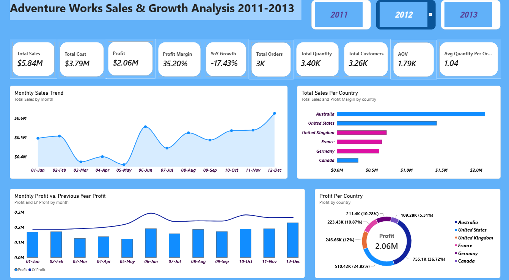
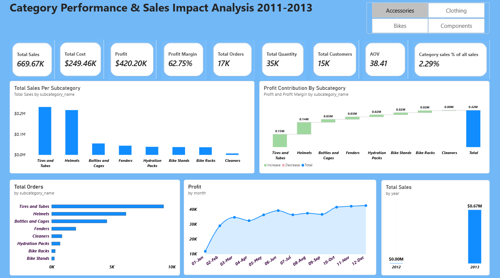
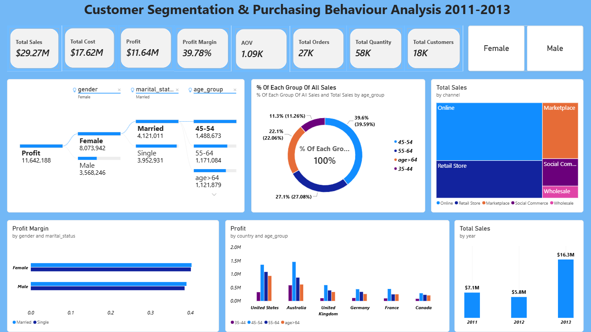

📊 AdventureWorks | Power BI Business Intelligence Project

An interactive Business Intelligence project developed using Microsoft Power BI to transform business data into a structured analytical model and insightful reports, enabling comprehensive analysis of sales performance, product categories, and customer behavior.

📁 Project Structure

01. Data Preparation & Modeling

🗄️ Data preparation, transformation, relationship design, and analytical data modeling using Power Query and Power BI.

📂 "1_Data_Preparation_and_Modeling/"

02. Business Analysis

📈 Interactive business performance analysis using DAX measures and Power BI visualizations to explore sales trends, product performance, category contributions, and customer behavior.

📂 "02_Business_Analysis/"

🖼️ Project Visuals

🧩 Data Model

Star Schema Data Model

📊 Business Intelligence Reports

1. Sales Performance Analysis

2. Category & Subcategory Analysis

3. Customer Analysis

🛠️ Technologies & Tools

- Microsoft Power BI — Business Intelligence and Reporting
- Power Query (M) — Data Extraction and Transformation
- DAX — Analytical Measures and Calculations
- Data Modeling — Star Schema and Relationship Design
- Data Visualization — Interactive Charts and Reports

🎯 Project Scope

"Data Preparation" · "Data Transformation" · "Data Modeling" · "DAX" · "Business Intelligence" · "Data Visualization" · "Business Performance Analysis"